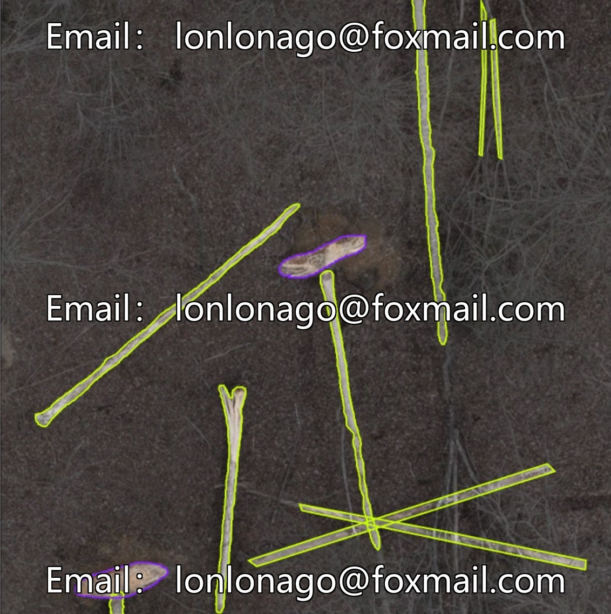
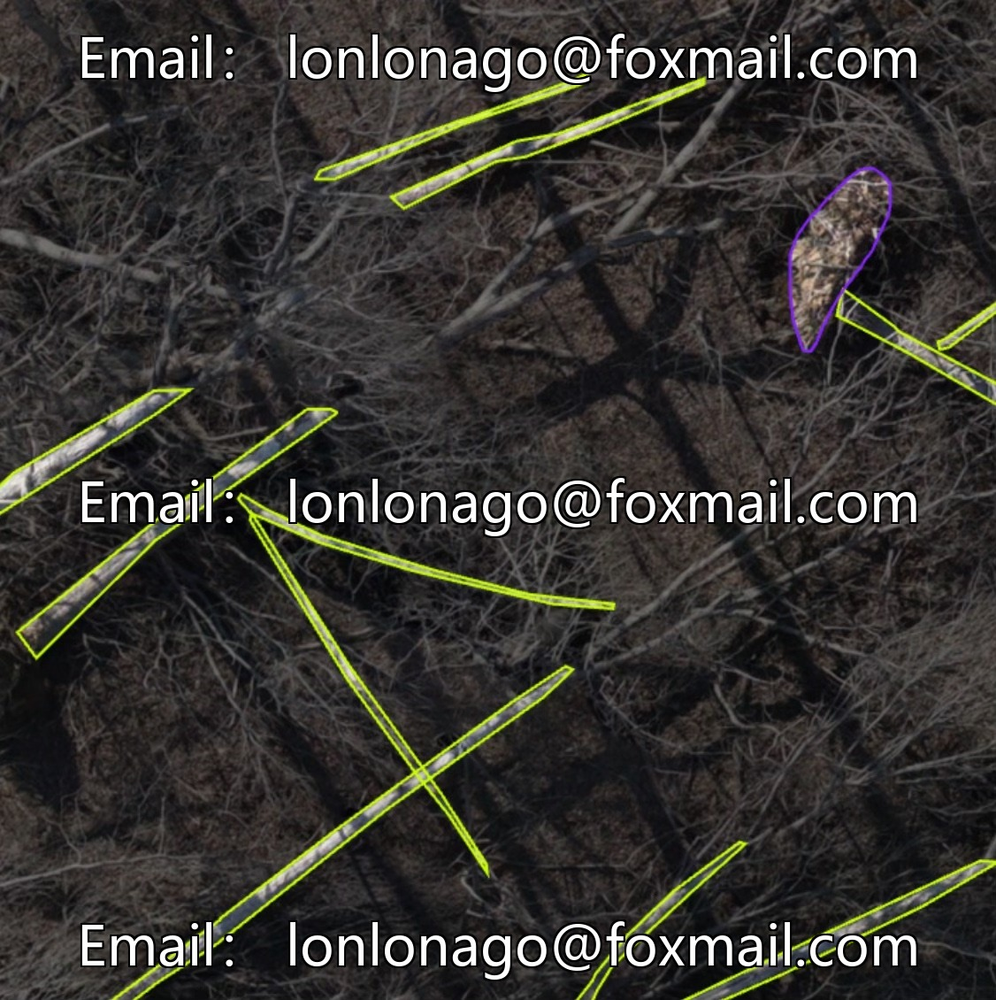
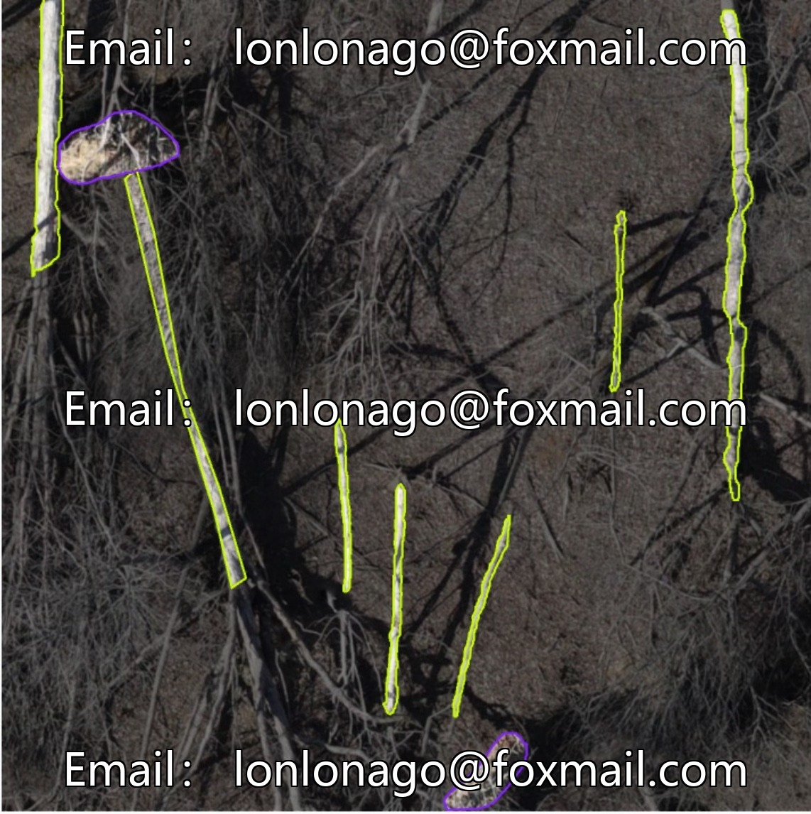
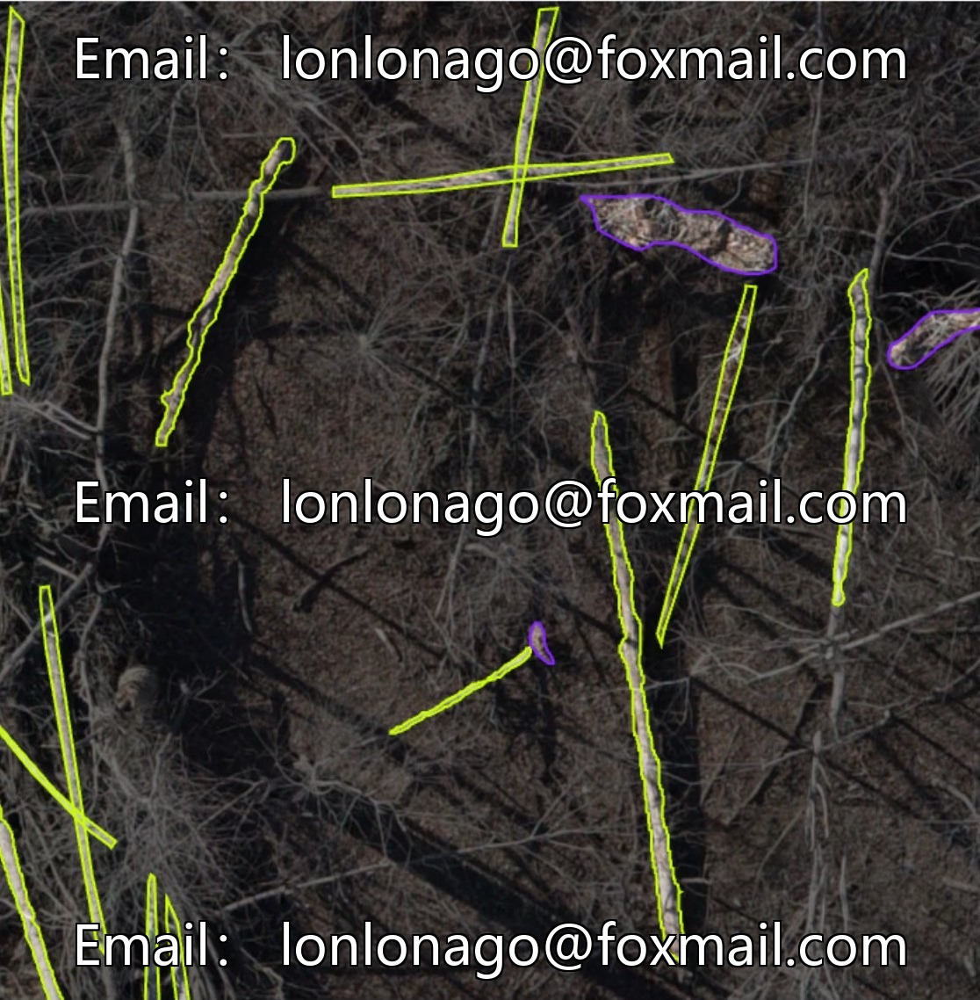

# Forest dead branches and fallen leaves target detection dataset, drone aerial photography, dead branches, fallen leaves, weeds, etc.

## Body

Forest dead branches and fallen leaves target detection dataset, aerial photography of drones, scene annotation for dead branches, fallen leaves, weeds, etc., suitable for training target detection models, supports mainstream formats such as YOLO, detr. Core data statistics

Category Composition: The dataset consists of 2 labeled categories, namely tree toppling and root coverage, encompassing the complete shape of the target instances and their associated scene features.
Image Scale: It comprises 20,000 high-definition labeled images, covering various perspectives such as aerial photography and ground shooting, catering to the algorithm training needs of different acquisition devices.
Annotation Format: The data is organized in YOLO format by default, with annotation files stored in TXT format, including object category index and normalized coordinate information. This allows for direct integration into mainstream instance segmentation models like YOLOv11 for training.

The dataset includes multi-angle annotations for dead branches, fallen leaves, weeds, etc., covering common targets on forest surfaces, suitable for intelligent recognition, environmental monitoring, forestry research and other scenarios.

Virtual materials, once sold, are non-refundable.
Interested friends, click "I want" to proceed.

## Images

## Payment

Here is a pay link on Stripe ( https://buy.stripe.com/3cs8yP7sY87d0vu9AB ). Please contact me lonlonago@foxmail.com after funding $89, and I will send you a complete data files , thank you!

